This page describes the spectral bands of the Sentinel-2 MultiSpectral Instrument (MSI) and
the simple RGB composites that can be made from them. Every example comes with a minimal
[evalscript](/APIs/SentinelHub/Evalscript.qmd) that you can use with Sentinel Hub or paste into
the custom script editor of the [Copernicus Browser](/Applications/Browser.qmd).

All examples multiply the reflectance values by a gain of 2.5 to brighten the image. Adjust this
factor to suit your area of interest.

## Bands

The values below are approximate and common to both Sentinel-2 satellites. For the exact central
wavelengths of each satellite and for the full list of available bands (including angles and
`dataMask`), see the band tables for [Sentinel-2 L1C](/APIs/SentinelHub/Data/S2L1C.qmd#available-bands-and-data)
and [Sentinel-2 L2A](/APIs/SentinelHub/Data/S2L2A.qmd#available-bands-and-data).
For more on the instrument itself, see [SentiWiki](https://sentiwiki.copernicus.eu/web/s2-mission).

| Band | Description | Central wavelength (nm) | Bandwidth (nm) | Resolution (m) |
|------|-------------|------------------------:|---------------:|---------------:|
| [B01](#b01) | Coastal aerosol | 443 | 20 | 60 |
| [B02](#b02) | Blue | 490 | 65 | 10 |
| [B03](#b03) | Green | 560 | 35 | 10 |
| [B04](#b04) | Red | 665 | 30 | 10 |
| [B05](#b05) | Vegetation red edge | 705 | 15 | 20 |
| [B06](#b06) | Vegetation red edge | 740 | 15 | 20 |
| [B07](#b07) | Vegetation red edge | 783 | 20 | 20 |
| [B08](#b08) | NIR | 842 | 115 | 10 |
| [B8A](#b8a) | Narrow NIR | 865 | 20 | 20 |
| [B09](#b09) | Water vapour | 945 | 20 | 60 |
| [B10](#b10) | SWIR – Cirrus | 1375 | 30 | 60 |
| [B11](#b11) | SWIR 1 | 1610 | 90 | 20 |
| [B12](#b12) | SWIR 2 | 2190 | 180 | 20 |

### B01 {#b01}

*Coastal aerosol, central wavelength 443 nm, bandwidth 20 nm, resolution 60 m.*

**Use:** For aerosol detection.

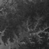

``` javascript
//VERSION=3
function setup() {
  return {
    input: ["B01"],
    output: { bands: 1 }
  };
}

function evaluatePixel(samples) {
  return [2.5 * samples.B01];
}
```

### B02 {#b02}

*Blue, central wavelength 490 nm, bandwidth 65 nm, resolution 10 m.*

**Use:** Band 2 is useful for soil and vegetation discrimination, forest type mapping and identifying man-made features. It is scattered by the atmosphere, it illuminates material in shadows better than longer wavelengths, and it penetrates clear water better than other colours. It is absorbed by chlorophyll, which results in darker plants.

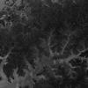

``` javascript
//VERSION=3
function setup() {
  return {
    input: ["B02"],
    output: { bands: 1 }
  };
}

function evaluatePixel(samples) {
  return [2.5 * samples.B02];
}
```

### B03 {#b03}

*Green, central wavelength 560 nm, bandwidth 35 nm, resolution 10 m.*

**Use:** It gives excellent contrast between clear and turbid (muddy) water, and penetrates clear water fairly well. It helps in highlighting oil on water surfaces, and vegetation. It reflects green light stronger than any other visible colour. Man-made features are still visible.

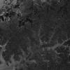

``` javascript
//VERSION=3
function setup() {
  return {
    input: ["B03"],
    output: { bands: 1 }
  };
}

function evaluatePixel(samples) {
  return [2.5 * samples.B03];
}
```

### B04 {#b04}

*Red, central wavelength 665 nm, bandwidth 30 nm, resolution 10 m.*

**Use:** It is strongly reflected by dead foliage and is useful for identifying vegetation types, soils and urban (city and town) areas. It has limited water penetration and does not reflect well from live foliage with chlorophyll.

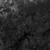

``` javascript
//VERSION=3
function setup() {
  return {
    input: ["B04"],
    output: { bands: 1 }
  };
}

function evaluatePixel(samples) {
  return [2.5 * samples.B04];
}
```

### B05 {#b05}

*Vegetation red edge, central wavelength 705 nm, bandwidth 15 nm, resolution 20 m.*

**Use:** For classifying vegetation.

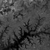

``` javascript
//VERSION=3
function setup() {
  return {
    input: ["B05"],
    output: { bands: 1 }
  };
}

function evaluatePixel(samples) {
  return [2.5 * samples.B05];
}
```

### B06 {#b06}

*Vegetation red edge, central wavelength 740 nm, bandwidth 15 nm, resolution 20 m.*

**Use:** For classifying vegetation.

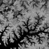

``` javascript
//VERSION=3
function setup() {
  return {
    input: ["B06"],
    output: { bands: 1 }
  };
}

function evaluatePixel(samples) {
  return [2.5 * samples.B06];
}
```

### B07 {#b07}

*Vegetation red edge, central wavelength 783 nm, bandwidth 20 nm, resolution 20 m.*

**Use:** For classifying vegetation.


``` javascript
//VERSION=3
function setup() {
  return {
    input: ["B07"],
    output: { bands: 1 }
  };
}

function evaluatePixel(samples) {
  return [2.5 * samples.B07];
}
```

### B08 {#b08}

*NIR, central wavelength 842 nm, bandwidth 115 nm, resolution 10 m.*

**Use:** The near infrared band is good for mapping shorelines and biomass content, as well as at detecting and analysing vegetation.

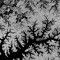

``` javascript
//VERSION=3
function setup() {
  return {
    input: ["B08"],
    output: { bands: 1 }
  };
}

function evaluatePixel(samples) {
  return [2.5 * samples.B08];
}
```

### B8A {#b8a}

*Narrow NIR, central wavelength 865 nm, bandwidth 20 nm, resolution 20 m.*

**Use:** For classifying vegetation.

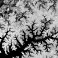

``` javascript
//VERSION=3
function setup() {
  return {
    input: ["B8A"],
    output: { bands: 1 }
  };
}

function evaluatePixel(samples) {
  return [2.5 * samples.B8A];
}
```

### B09 {#b09}

*Water vapour, central wavelength 945 nm, bandwidth 20 nm, resolution 60 m.*

**Use:** It is good for detecting water vapour.

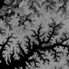

``` javascript
//VERSION=3
function setup() {
  return {
    input: ["B09"],
    output: { bands: 1 }
  };
}

function evaluatePixel(samples) {
  return [2.5 * samples.B09];
}
```

### B10 {#b10}

*SWIR – Cirrus, central wavelength 1375 nm, bandwidth 30 nm, resolution 60 m.*

**Use:** For cirrus cloud detection.


``` javascript
//VERSION=3
function setup() {
  return {
    input: ["B10"],
    output: { bands: 1 }
  };
}

function evaluatePixel(samples) {
  return [2.5 * samples.B10];
}
```

### B11 {#b11}

*SWIR 1, central wavelength 1610 nm, bandwidth 90 nm, resolution 20 m.*

**Use:** It is useful for measuring the moisture content of soil and vegetation, and it provides good contrast between different types of vegetation. It helps differentiate between snow and clouds. On the other hand, it has limited cloud penetration.

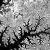

``` javascript
//VERSION=3
function setup() {
  return {
    input: ["B11"],
    output: { bands: 1 }
  };
}

function evaluatePixel(samples) {
  return [2.5 * samples.B11];
}
```

### B12 {#b12}

*SWIR 2, central wavelength 2190 nm, bandwidth 180 nm, resolution 20 m.*

**Use:** It is useful for measuring the moisture content of soil and vegetation, and it provides good contrast between different types of vegetation. It helps differentiate between snow and clouds. On the other hand, it has limited cloud penetration.

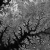

``` javascript
//VERSION=3
function setup() {
  return {
    input: ["B12"],
    output: { bands: 1 }
  };
}

function evaluatePixel(samples) {
  return [2.5 * samples.B12];
}
```

## Simple RGB composites

An RGB composite displays three bands in the red, green and blue channels of an image. The band numbers in each heading are listed in that order.

### True colour (4, 3, 2)

The true colour composite uses the visible light bands red (B04), green (B03) and blue (B02) in the corresponding red, green and blue colour channels. The result is a naturally coloured image that is a good representation of the Earth as humans would see it.

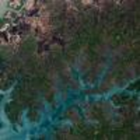

``` javascript
//VERSION=3
function setup() {
  return {
    input: ["B04", "B03", "B02"],
    output: { bands: 3 }
  };
}

function evaluatePixel(samples) {
  return [2.5 * samples.B04, 2.5 * samples.B03, 2.5 * samples.B02];
}
```

A more complete version of this visualisation is available in the [custom scripts repository](https://custom-scripts.sentinel-hub.com/sentinel-2/true_color/).

References:

- [Sentinel-2 mission (SentiWiki)](https://sentiwiki.copernicus.eu/web/s2-mission)

### False colour (8, 4, 3)

This false colour composite combines the near infrared (B08), red (B04) and green (B03) bands and is very popular. It is most commonly used to assess plant density and health, as plants reflect near infrared and green light while absorbing red. Since they reflect more near infrared than green, plant-covered land appears deep red. Denser plant growth is darker red. Cities and exposed ground are grey or tan, and water appears blue or black.

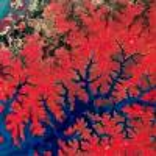

``` javascript
//VERSION=3
function setup() {
  return {
    input: ["B08", "B04", "B03"],
    output: { bands: 3 }
  };
}

function evaluatePixel(samples) {
  return [2.5 * samples.B08, 2.5 * samples.B04, 2.5 * samples.B03];
}
```

A more complete version of this visualisation is available in the [custom scripts repository](https://custom-scripts.sentinel-hub.com/sentinel-2/false_color_infrared/).

References:

- [NASA Earth Observatory: Why is that Forest Red and that Cloud Blue?](https://earthobservatory.nasa.gov/features/FalseColor/page6.php)

### SWIR (12, 8, 4)

Short wave infrared (SWIR) bands 11 and 12 can help scientists estimate how much water is present in plants and soil, as water reflects SWIR wavelengths. Shortwave infrared bands are also useful for distinguishing between cloud types (water clouds versus ice clouds), snow and ice, all of which appear white in visible light. Newly burned land reflects strongly in SWIR bands, making them valuable for mapping fire damage. Each rock type reflects shortwave infrared light differently, making it possible to map out geology by comparing reflected SWIR light. In this composite, the near infrared band (B08) is reflected by vegetation and shown in the green channel, while the red band (B04), highlighting bare soil and built-up areas, is shown in the blue channel.

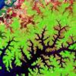

``` javascript
//VERSION=3
function setup() {
  return {
    input: ["B12", "B08", "B04"],
    output: { bands: 3 }
  };
}

function evaluatePixel(samples) {
  return [2.5 * samples.B12, 2.5 * samples.B08, 2.5 * samples.B04];
}
```

A more complete version of this visualisation is available in the [custom scripts repository](https://custom-scripts.sentinel-hub.com/sentinel-2/swir-rgb/).

References:

- [NASA Earth Observatory: How to Interpret a False-Color Satellite Image](https://earthobservatory.nasa.gov/features/FalseColor/page5.php)
- [GIS Geography: Sentinel-2 Bands and Combinations](https://gisgeography.com/sentinel-2-bands-combinations/)

### Agriculture (11, 8, 2)

This composite, often called the Agriculture RGB composite, uses the SWIR 1 (B11), near infrared (B08) and blue (B02) bands. It is mostly used to monitor crop health, as both shortwave and near infrared bands are particularly good at highlighting dense vegetation, which appears dark green in the composite. SWIR measurements can help scientists estimate how much water is present in plants and soil, as water reflects SWIR light. Shortwave infrared bands are also useful for distinguishing between snow and ice, all of which appear white in visible light. Newly burned land reflects strongly in SWIR bands, making them valuable for mapping fire damage.

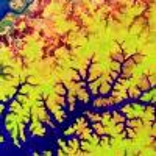

``` javascript
//VERSION=3
function setup() {
  return {
    input: ["B11", "B08", "B02"],
    output: { bands: 3 }
  };
}

function evaluatePixel(samples) {
  return [2.5 * samples.B11, 2.5 * samples.B08, 2.5 * samples.B02];
}
```

A more complete version of this visualisation is available in the [custom scripts repository](https://custom-scripts.sentinel-hub.com/sentinel-2/infrared_agriculture_display/).

References:

- [NASA Earth Observatory: How to Interpret a False-Color Satellite Image](https://earthobservatory.nasa.gov/features/FalseColor/page5.php)
- [GIS Geography: Sentinel-2 Bands and Combinations](https://gisgeography.com/sentinel-2-bands-combinations/)

### Geology (12, 11, 2)

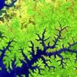

``` javascript
//VERSION=3
function setup() {
  return {
    input: ["B12", "B11", "B02"],
    output: { bands: 3 }
  };
}

function evaluatePixel(samples) {
  return [2.5 * samples.B12, 2.5 * samples.B11, 2.5 * samples.B02];
}
```

### Bathymetric (4, 3, 1)

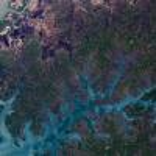

``` javascript
//VERSION=3
function setup() {
  return {
    input: ["B04", "B03", "B01"],
    output: { bands: 3 }
  };
}

function evaluatePixel(samples) {
  return [2.5 * samples.B04, 2.5 * samples.B03, 2.5 * samples.B01];
}
```

### RGB (8, 6, 4)

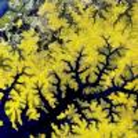

``` javascript
//VERSION=3
function setup() {
  return {
    input: ["B08", "B06", "B04"],
    output: { bands: 3 }
  };
}

function evaluatePixel(samples) {
  return [2.5 * samples.B08, 2.5 * samples.B06, 2.5 * samples.B04];
}
```

### RGB (8, 5, 4)

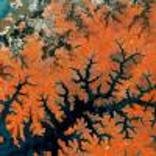

``` javascript
//VERSION=3
function setup() {
  return {
    input: ["B08", "B05", "B04"],
    output: { bands: 3 }
  };
}

function evaluatePixel(samples) {
  return [2.5 * samples.B08, 2.5 * samples.B05, 2.5 * samples.B04];
}
```

### RGB (8, 11, 4)

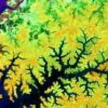

``` javascript
//VERSION=3
function setup() {
  return {
    input: ["B08", "B11", "B04"],
    output: { bands: 3 }
  };
}

function evaluatePixel(samples) {
  return [2.5 * samples.B08, 2.5 * samples.B11, 2.5 * samples.B04];
}
```

### RGB (8, 11, 12)

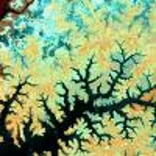

``` javascript
//VERSION=3
function setup() {
  return {
    input: ["B08", "B11", "B12"],
    output: { bands: 3 }
  };
}

function evaluatePixel(samples) {
  return [2.5 * samples.B08, 2.5 * samples.B11, 2.5 * samples.B12];
}
```

### RGB (11, 8, 3)

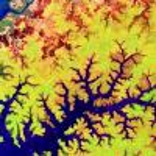

``` javascript
//VERSION=3
function setup() {
  return {
    input: ["B11", "B08", "B03"],
    output: { bands: 3 }
  };
}

function evaluatePixel(samples) {
  return [2.5 * samples.B11, 2.5 * samples.B08, 2.5 * samples.B03];
}
```
