This page describes the spectral bands of the Sentinel-3 Ocean and Land Colour Instrument (OLCI)
and the simple RGB composites that can be made from them. Every example comes with a minimal
[evalscript](/APIs/SentinelHub/Evalscript.qmd) that you can use with Sentinel Hub or paste into
the custom script editor of the [Copernicus Browser](/Applications/Browser.qmd).

All examples multiply the reflectance values by a gain of 2.5 to brighten the image. Adjust this
factor to suit your area of interest.

## Bands

All OLCI bands have a spatial resolution of 300 m. The typical use of each band, and the
other available inputs (quality flags, angles, meteo bands and `dataMask`), are listed in the
[Sentinel-3 OLCI L1B band table](/APIs/SentinelHub/Data/S3OLCI.qmd#available-bands-and-data).
For more on the instrument, see [SentiWiki](https://sentiwiki.copernicus.eu/web/s3-olci-instrument).

Each band can be visualised on its own with an evalscript like this one for B01:

``` javascript
//VERSION=3
function setup() {
  return {
    input: ["B01"],
    output: { bands: 1 }
  };
}

function evaluatePixel(samples) {
  return [2.5 * samples.B01];
}
```

| Band | Central wavelength (nm) | Bandwidth (nm) | Resolution (m) | Example |
|------|------------------------:|---------------:|---------------:|---------|
| B01 | 400 | 15 | 300 | 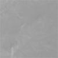 |
| B02 | 412 | 10 | 300 | 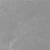 |
| B03 | 442.5 | 10 | 300 | 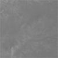 |
| B04 | 490 | 10 | 300 | 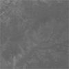 |
| B05 | 510 | 10 | 300 | 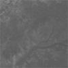 |
| B06 | 560 | 10 | 300 | 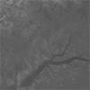 |
| B07 | 620 | 10 | 300 | 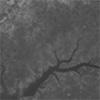 |
| B08 | 665 | 10 | 300 |  |
| B09 | 673.75 | 7.5 | 300 | 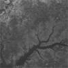 |
| B10 | 681.25 | 7.5 | 300 |  |
| B11 | 708.75 | 10 | 300 | 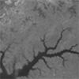 |
| B12 | 753.75 | 7.5 | 300 | 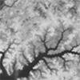 |
| B13 | 761.25 | 2.5 | 300 | 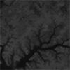 |
| B14 | 764.375 | 3.75 | 300 | 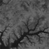 |
| B15 | 767.5 | 2.5 | 300 | 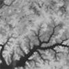 |
| B16 | 778.75 | 15 | 300 | 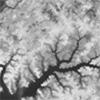 |
| B17 | 865 | 20 | 300 | 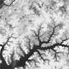 |
| B18 | 885 | 10 | 300 |  |
| B19 | 900 | 10 | 300 | 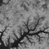 |
| B20 | 940 | 20 | 300 | 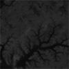 |
| B21 | 1020 | 40 | 300 | 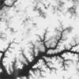 |

Source: Shen-En Qian (ed.), *Optical Payloads for Space Missions*, Wiley, 2015, p. 233.

## Simple RGB composites

An RGB composite displays three bands in the red, green and blue channels of an image. The band numbers in each heading are listed in that order.

### True colour (8, 6, 4)

The true colour composite uses the OLCI bands closest to visible red (B08, 665 nm), green (B06, 560 nm) and blue (B04, 490 nm) in the corresponding red, green and blue colour channels. The result is a naturally coloured image that is a good representation of the Earth as humans would see it.

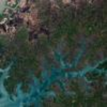

``` javascript
//VERSION=3
function setup() {
  return {
    input: ["B08", "B06", "B04"],
    output: { bands: 3 }
  };
}

function evaluatePixel(samples) {
  return [2.5 * samples.B08, 2.5 * samples.B06, 2.5 * samples.B04];
}
```

A more complete version of this visualisation is available in the [custom scripts repository](https://custom-scripts.sentinel-hub.com/sentinel-3/enhanced_true_color/).

References:

- [OLCI instrument (SentiWiki)](https://sentiwiki.copernicus.eu/web/s3-olci-instrument)

### False colour (17, 6, 3)

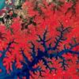

``` javascript
//VERSION=3
function setup() {
  return {
    input: ["B17", "B06", "B03"],
    output: { bands: 3 }
  };
}

function evaluatePixel(samples) {
  return [2.5 * samples.B17, 2.5 * samples.B06, 2.5 * samples.B03];
}
```

### False colour (17, 5, 2)

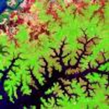

``` javascript
//VERSION=3
function setup() {
  return {
    input: ["B17", "B05", "B02"],
    output: { bands: 3 }
  };
}

function evaluatePixel(samples) {
  return [2.5 * samples.B17, 2.5 * samples.B05, 2.5 * samples.B02];
}
```

For a colour-accurate visualisation based on many OLCI bands, see the [tristimulus script](https://custom-scripts.sentinel-hub.com/sentinel-3/tristimulus/) in the custom scripts repository.
