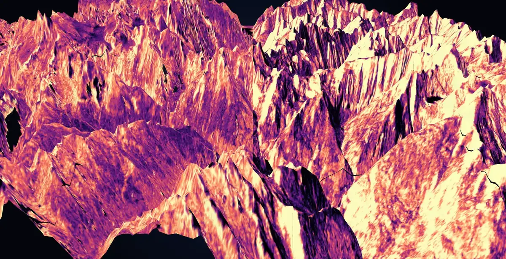

Sentinel-1 radar backscatter can be processed 
in the cloud with openEO on the Copernicus Data Space Ecosystem.
This guide calibrates the same Sentinel-1 data in two ways, 
**γ⁰ (gamma0, terrain-flattened)** and **σ⁰ (sigma0, ellipsoid)**, 
compares what each costs, and then compares the results on a map.

For beginners in openEO and SAR processing, we recommend carefully reading
through the first sections and trying to understand the difference in output.
For advanced users, the last two sections contain background and details on 
used methods and options to finetune the output.

## Two ways to calibrate backscatter

Sentinel-1 GRD data is calibrated to backscatter in the `sar_backscatter` process. The `coefficient` argument decides how the signal is normalised:

- `sigma0-ellipsoid` (σ⁰) normalises by the area on the ellipsoid. It needs no terrain flattening, so less processing is expected, but slopes facing the sensor look much brighter than slopes facing away from it.
- `gamma0-terrain` (γ⁰) is radiometrically terrain-flattened. It needs an extra processing step, so more processing is expected, and it removes most of the slope-induced brightness differences.

We run both for exactly the same area and period, first compare their cost in terms of credits and resources, and then look at how the output differs.
The example is in a mountain area, which results in highest processing cost and output
difference. Expect smaller differences in more flat areas.

## Monthly composites over six months

Instead of a single composite, we take six months of data (May to October 2026)
and compute one median composite **per month**. 
The result has six dates per pixel, which allows us to look 
at pixel time series later on. Each composite is 
in decibel (`10·log10`) and resampled to Web Mercator (EPSG:3857) for visualization purposes.

The function below builds the monthly composite for a given backscatter coefficient, and exports the result to a workspace as a GeoTIFF per month and band, together with a STAC collection.

```{python}
import openeo
from openeo import collection_property

connection = openeo.connect("openeo-staging.dataspace.copernicus.eu").authenticate_oidc()

bbox = [1397574.0, 5935182.0, 1455819.0, 5999236.0]
# Test area: 1/10 of each side, around the centre
# bbox = [1423784.25, 5964006.3, 1429608.75, 5970412.7]
extent = dict(zip(["west", "south", "east", "north"], bbox), crs="EPSG:3857")
temporal_extent = ["2026-05-01", "2026-11-01"]


def monthly_composite(coefficient: str, **backscatter_args):
    """Monthly median backscatter composite in dB, in EPSG:3857 at 10 m.
    Extra arguments are passed on to `sar_backscatter`, see the advanced parameters below."""
    cube = connection.load_collection(
        "SENTINEL1_GRD",
        spatial_extent=extent,
        temporal_extent=temporal_extent,
        bands=["VV", "VH"],
        properties=[
            collection_property("sat:orbit_state") == "ascending",
            collection_property("sar:instrument_mode") == "IW",
        ],
    )
    cube = cube.sar_backscatter(coefficient=coefficient, **backscatter_args)
    cube = cube.aggregate_temporal_period("month", reducer="median")
    cube = cube.apply(lambda x: 10 * x.log(base=10))
    return cube.resample_spatial(projection=3857, resolution=10)


```

```{python}
#| echo: false
import json
from pathlib import Path

from IPython.display import HTML, Markdown
from openeo.internal.jupyter import render_component

def export_to_workspace(cube, collection: str):
    """Writes one COG per month and band, and merges their STAC items into the given collection."""
    result = cube.save_result(
        format="GTiff",
        options=dict(filename_prefix="median_composite", separate_asset_per_band=True),
    )
    return result.process(
        "export_workspace",
        arguments={"data": result, "workspace": "openeo-examples-workspace", "merge": collection},
    )

def run_job(name: str, cube, collection: str) -> dict:
    """Runs the export as a batch job once. The job id and metadata are cached in sar_processing_job_<name>.json,
    so later renders can show the job without re-running or re-fetching it."""
    job_file = Path(f"sar_processing_job_{name}.json")
    cache = json.loads(job_file.read_text()) if job_file.exists() else {}

    if "id" not in cache:
        job = export_to_workspace(cube, collection).create_job(
            title=f"SAR {name} monthly composites (docs)", job_options={"stac-version": "1.1"}, log_level="debug"
        )
        job.start_and_wait()
        cache = {"id": job.job_id, "collection": collection}

    if "metadata" not in cache:
        capabilities = connection.capabilities()
        cache["metadata"] = connection.job(cache["id"]).describe()
        cache["parameters"] = {
            "currency": capabilities.currency(),
            "federation": capabilities.ext_federation_backend_details(),
        }
        job_file.write_text(json.dumps(cache, indent=2))
    return cache


def show_job(cache: dict) -> HTML:
    return HTML(render_component("job", data=cache["metadata"], parameters=cache["parameters"]))
```

## Gamma0 (terrain-flattened)

We call the function defined above to compute the γ⁰ monthly composite.
The openEO job metadata is visualized afterwards, to give you an idea on what you can expect.


```{python}
gamma0 = monthly_composite("gamma0-terrain")
```

```{python}
#| echo: false
gamma0_job = run_job("gamma0", gamma0, "sar_processing_gamma0.json")
show_job(gamma0_job)
```

## Sigma0 (ellipsoid)

The sigma0 workflow is identical, except for the coefficient and the target collection.
For sigma0 we use `implementation_version` 3 of the backscatter processing, 
which is selected through the `options` of `sar_backscatter`. 

```{python}
sigma0 = monthly_composite("sigma0-ellipsoid", options={"implementation_version": "3"})
```

```{python}
#| echo: false
sigma0_job = run_job("sigma0", sigma0, "sar_processing_sigma0.json")
show_job(sigma0_job)
```

For reference, the same sigma0 composite was also computed with the previous default implementation
(`implementation_version` 2), so the cost of both versions can be compared below.

```{python}
sigma0_v2 = monthly_composite("sigma0-ellipsoid", options={"implementation_version": "2"})
```

```{python}
#| echo: false
sigma0_v2_job = run_job("sigma0_v2", sigma0_v2, "sar_processing_sigma0_v2.json")
show_job(sigma0_v2_job)
```

## Cost comparison

The batch job metadata contains the cost in credits and the resources that were used. To make the two jobs, and jobs of other sizes, easier to compare, the cost is also normalised per input megapixel and per 100 × 100 km output observation (one date over 10 000 km²).

```{python}
#| echo: false
import math

# Ground area of the bbox: EPSG:3857 stretches distances by 1/cos(latitude), so correct for the centre latitude.
R = 6378137.0
lat = math.atan(math.sinh((bbox[1] + bbox[3]) / 2 / R))
area_km2 = (bbox[2] - bbox[0]) * (bbox[3] - bbox[1]) * math.cos(lat) ** 2 / 1e6
start, end = (tuple(map(int, d.split("-")[:2])) for d in temporal_extent)
n_dates = (end[0] - start[0]) * 12 + end[1] - start[1]  # one composite per month
observations = area_km2 / (100 * 100) * n_dates  # 100 x 100 km observations


def usage_value(cache, key):
    entry = cache["metadata"].get("usage", {}).get(key)
    return entry["value"] if entry else None


def usage(cache, key):
    entry = cache["metadata"].get("usage", {}).get(key)
    return f"{entry['value']:,.0f} {entry['unit']}" if entry else "–"


def ratio(numerator, denominator, digits=3):
    return f"{numerator / denominator:,.{digits}f}" if numerator is not None and denominator else "–"


rows = [
    ("Credits", lambda c: f"{c['metadata'].get('costs', '–')}"),
    ("Duration", lambda c: usage(c, "duration")),
    ("CPU", lambda c: usage(c, "cpu")),
    ("Input", lambda c: usage(c, "input_pixel")),
    ("**Credits per input megapixel**", lambda c: ratio(c["metadata"].get("costs"), usage_value(c, "input_pixel"), 4)),
    ("Output observations (area × dates, in 100 × 100 km units)", lambda c: f"{observations:,.2f}"),
    ("**Credits per 100 × 100 km output observation**", lambda c: ratio(c["metadata"].get("costs"), observations, 2)),
]
jobs = [gamma0_job, sigma0_v2_job, sigma0_job]
table = ["| | γ⁰ terrain-flattened | σ⁰ ellipsoid (version 2) | σ⁰ ellipsoid (version 3) |", "|---|---|---|---|"]
table += [f"| {name} | " + " | ".join(fmt(j) for j in jobs) + " |" for name, fmt in rows]


def change(key, digits=0):
    old, new = (j["metadata"].get("costs") if key == "costs" else usage_value(j, key) for j in (sigma0_v2_job, sigma0_job))
    return f"{(new - old) / old:+.{digits}%}" if old and new is not None else "–"


table.append(
    f"| **Change of version 3 vs version 2** | | | credits {change('costs')}, duration {change('duration')}, "
    f"CPU {change('cpu')}, input {change('input_pixel')} |"
)
table.append("")
table.append(
    f"*The job produced {n_dates} dates over {area_km2:,.0f} km², i.e. {n_dates} × {area_km2 / 10000:.3f} = {observations:,.2f} "
    "observations of 100 × 100 km (10 000 km²), one observation being one date. Credits per observation = total credits / "
    "that number. The result is close to the total cost only because the number of dates and the fraction of 10 000 km² "
    "happen to nearly cancel out.*"
)
Markdown("\n".join(table))
```

## Comparing the results

Drag the slider to swipe between γ⁰ (left) and σ⁰ (right). Use the month selector to step through the six composites, and hover over the map to read both values and their difference.

Both products show the same scene, but they differ where the terrain is steep: with σ⁰, slopes that face the sensor are bright and slopes that face away are dark, which gives the image a relief-like look that is caused by the viewing geometry rather than by the land cover. γ⁰ removes most of this effect, so that surfaces with the same land cover get more similar values. On flat terrain, the two are nearly identical.

The data is loaded from the produced COG and rendered in 3D.
Be aware that data loading may take time depending on your network connection.

```{=html}
<link rel="stylesheet" href="sar_processing_viewer.css">
<div class="sar-viewer" id="sar-viewer-compare">
  <div class="sar-map"></div>
  <div class="sar-status" hidden></div>
  <div class="sar-tooltip" hidden></div>

  <div class="sar-panel">
    <div class="sar-head">
      <h4>Sentinel-1 backscatter</h4>
      <button type="button" class="sar-icon" data-ctl="advanced" title="Advanced settings" aria-label="Advanced settings" aria-expanded="false">⚙</button>
    </div>
    <label data-row="date" hidden>Month <select data-ctl="date"></select></label>
    <div class="sar-row">
      <button type="button" data-ctl="projection">Switch to globe</button>
      <button type="button" data-ctl="fly">Zoom to data</button>
    </div>
    <button type="button" data-ctl="fullscreen">Fullscreen</button>
  </div>

  <div class="sar-panel sar-advanced" hidden>
    <h4>Advanced settings</h4>
    <label>Layer
      <select data-ctl="band">
        <option value="VV">VV</option>
        <option value="VH">VH</option>
        <option value="RATIO">VH − VV (ratio)</option>
      </select>
    </label>
    <label>Colormap <select data-ctl="cmap"></select></label>
    <label class="sar-check" title="Tilted flat map with elevation (Terrarium tiles)"><input type="checkbox" data-ctl="terrain" checked> 3D terrain</label>
    <div class="sar-hist-wrap"><canvas class="sar-hist"></canvas></div>
    <label>Min <output data-out="min"></output><input type="range" data-ctl="min"></label>
    <label>Max <output data-out="max"></output><input type="range" data-ctl="max"></label>
    <button type="button" data-ctl="auto">Auto contrast (2–98 %)</button>
    <label>Opacity <input type="range" data-ctl="opacity" min="0" max="1" step="0.05" value="0.95"></label>
    <label data-row="exaggeration" hidden>Vertical exaggeration <output data-out="exaggeration">3.0×</output><input type="range" data-ctl="exaggeration" min="1" max="8" step="0.5" value="3"></label>
  </div>

  <div class="sar-legend">
    <span data-out="legtitle"></span>
    <div class="sar-legend-bar"></div>
    <div class="sar-legend-labels"><span data-out="legmin"></span><span data-out="legmax"></span></div>
  </div>
  <div class="sar-hint">Drag to rotate · scroll to zoom · Ctrl/⌘ + drag to tilt · hover for pixel values</div>

  <div class="sar-poster">
    
    <div class="sar-poster-msg">Loading Sentinel-1 data…</div>
  </div>
</div>

<script type="module">
  import { createViewer, loadCollectionSource } from "./sar_processing_viewer.js";
  const bucket = "https://s3.waw3-1.cloudferro.com/openeo-examples/";
  const root = document.getElementById("sar-viewer-compare");
  const showError = (err) => {
    console.error(err);
    root.querySelector(".sar-poster")?.remove();
    const st = root.querySelector(".sar-status");
    st.hidden = false; st.dataset.kind = "error";
    st.textContent = "Could not open the gamma0 / sigma0 collections.";
  };
  try {
    const [gamma0, sigma0] = await Promise.all([
      loadCollectionSource("γ⁰", `${bucket}sar_processing_gamma0.json`),
      loadCollectionSource("σ⁰", `${bucket}sar_processing_sigma0.json`),
    ]);
    const [w, s, e, n] = gamma0.bbox;
    await createViewer(root, {
      sources: [gamma0, sigma0],
      proj: gamma0.proj,
      bands: ["VV"],
      db: true,
      center: [(w + e) / 2, (s + n) / 2],
    });
  } catch (err) {
    showError(err);
  }
</script>
```

## Advanced parameters

Besides `coefficient`, the `sar_backscatter` process has a few more arguments, and the back-end accepts non-standard fine-tuning through the `options` dictionary. The defaults are what the examples above used.

| argument | default | description |
|---|---|---|
| `coefficient` | `"gamma0-terrain"` | A value starting with `gamma0` gives terrain-flattened γ⁰. Any other value gives σ⁰. |
| `elevation_model` | back-end default (`COPERNICUS_30`) | The DEM: `"COPERNICUS_30"`, the URL of a STAC collection (`https://<host>/<root>/collections/<id>`) whose items hold the DEM rasters, or the string `"null"` for no DEM (terrain height 0 m). |
| `mask` | `False` | Also mask shadow and layover pixels. |
| `noise_removal` | `True` | Not yet supported by the terrain-correction back-end; currently ignored. |
| `options` | `{}` | Non-standard options, see below. |

These `options` are supported but are not 
considered part of the stable API and are subject 
to change without prior notice::

| option | default | description |
|---|---|---|
| `dem_asset` | `"data"` | Asset key of the DEM raster in the items of a STAC `elevation_model` collection. |
| `cast_shadow` | `True` | Also mask pixels in cast shadow. |
| `rtc_algorithm` | `"auto"` | Terrain-flattening algorithm for γ⁰: `angle`, `bilinear_distribution` or `auto` (see [below](#terrain-flattening-gamma0-algorithms)). Also settable as a back-end default with the `S1_RTC_ALGORITHM` environment variable. |
| `rtc_dem_upsampling` | `2` | Number of DEM facets per output pixel, per axis (area-based algorithm only). |
| `rtc_dem_margin_pixels` | `20` | DEM margin around each tile, in output pixels (area-based algorithm only). |
| `rtc_min_value_db` | none | Pixels with a normalisation factor below this value, in dB, become NaN (area-based algorithm only). |
| `rtc_auto_min_local_incidence` | `20` | Degrees. With `auto`, pixels below this local incidence angle count as steep. |
| `rtc_auto_max_local_incidence` | `70` | Degrees. With `auto`, pixels above this local incidence angle count as steep. |
| `rtc_auto_dilation_pixels` | `2` | With `auto`, the neighbourhood around steep pixels that is also computed area-based. |
| `rtc_auto_tile_fraction` | `0.02` | With `auto`, the fraction of steep pixels above which the whole tile is computed area-based. |
| `rtc_method_band` | `False` | Add a band with the algorithm used per pixel (0 = angle, 1 = area-based). Useful to see where `auto` switched. |

The arguments and options are set directly on `sar_backscatter`, which `monthly_composite()` passes them on to. This example computes γ⁰ with a custom steepness range for the `auto` algorithm and with the shadow and layover mask:

```{python}
#| eval: false
gamma0_custom = monthly_composite(
    "gamma0-terrain",
    elevation_model="COPERNICUS_30",
    mask=True,
    options={
        "rtc_algorithm": "auto",
        "rtc_auto_min_local_incidence": 15,
        "rtc_auto_max_local_incidence": 75,
        "rtc_auto_dilation_pixels": 3,
        "cast_shadow": True,
    },
)
```

To trade accuracy for cost, force the cheaper algorithm for all pixels with `options={"rtc_algorithm": "angle"}`, or the accurate and more expensive one with `options={"rtc_algorithm": "bilinear_distribution"}`.

Note that `local_incidence_angle=True`, `ellipsoid_incidence_angle=True` and `rtc_method_band` add extra bands to the result. `monthly_composite()` converts all bands to decibel, so for those options, only apply the `10·log10` conversion to the backscatter bands.

## Underlying implementation

The back-end computes `sar_backscatter` for Sentinel-1 GRD 
with the `sar-terrain-correction` module of 
[openeo-geotrellis-extensions](https://github.com/Open-EO/openeo-geotrellis-extensions/blob/develop/sar-terrain-correction/README.md). 


**Elevation model.** The DEM is selected with `elevation_model`. 
Height is 0 m where no item exists (sea, coast) or the DEM has no data. A bundled EGM96 geoid is applied to convert to ellipsoidal heights.

### Terrain flattening (gamma0) algorithms

For `coefficient="gamma0-terrain"`, the `rtc_algorithm` option selects how σ⁰ is flattened. σ⁰ itself is not affected.

| `rtc_algorithm` | method | cost |
|---|---|---|
| `angle` | Per pixel `σ⁰ · tan θ_loc / sin θ_el`, from the DEM-derived local incidence angle (Vollrath et al. 2020, after Ulander 1996 and Hoekman & Reiche 2015). | low |
| `bilinear_distribution` | Area-based: DEM facets are projected into radar geometry and their gamma area is summed per radar pixel, so that `γ⁰ = β⁰ / ANF` with β⁰ from the `betaNought` calibration LUT. A port of ISCE3 `computeRtcBilinearDistribution`, the method of Small (2011) as used by OPERA RTC-S1. Accurate on steep slopes and in layover. | high, about 10–20× the geometry work of `angle` |
| `auto` (default) | Per tile: if no pixel is steep (local incidence angle outside the min/max range), only `angle` is used. If at least `rtc_auto_tile_fraction` of the pixels are steep, the whole tile is area-based. Otherwise the area-based method is used only for the steep pixels and their neighbourhood, and `angle` elsewhere. | in between |


**Memory.** A tile computation is limited to about 512 MB of executor memory. Larger tiles are computed in blocks that each stay within this limit, and are assembled into the requested tile. With `auto`, the algorithm is chosen per block.


### References

- Vollrath, A., Mullissa, A., Reiche, J. (2020). Angular-Based Radiometric Slope Correction for Sentinel-1 on Google Earth Engine. *Remote Sensing* 12(11), 1867. [doi:10.3390/rs12111867](https://doi.org/10.3390/rs12111867)
- Hoekman, D.H., Reiche, J. (2015). Multi-model radiometric slope correction of SAR images of complex terrain using a two-stage semi-empirical approach. *Remote Sensing of Environment* 156, 1–10. [doi:10.1016/j.rse.2014.08.037](https://doi.org/10.1016/j.rse.2014.08.037)
- Ulander, L.M.H. (1996). Radiometric slope correction of synthetic-aperture radar images. *IEEE TGRS* 34(5), 1115–1122. [doi:10.1109/36.536527](https://doi.org/10.1109/36.536527)
- Small, D. (2011). Flattening Gamma: Radiometric Terrain Correction for SAR Imagery. *IEEE TGRS* 49(8), 3081–3093. [doi:10.1109/TGRS.2011.2120616](https://doi.org/10.1109/TGRS.2011.2120616)
- ISCE3, `cxx/isce3/geometry/RTC.cpp`, Caltech/JPL, Apache-2.0: <https://github.com/isce-framework/isce3>

The full documentation is in the [module README on GitHub](https://github.com/Open-EO/openeo-geotrellis-extensions/blob/develop/sar-terrain-correction/README.md), and the parameters are defined in [`SarBackscatterParameters.scala`](https://github.com/Open-EO/openeo-geotrellis-extensions/blob/develop/sar-terrain-correction/src/main/scala/org/openeo/sar/SarBackscatterParameters.scala).
