The CSV Catalogue is a web application for browsing, previewing and downloading the product inventories of the Copernicus Data Space Ecosystem. It offers daily lists of every product in the Copernicus archive, as CSV files: one file per satellite per day (for CLMS, one file per dataset), from December 2015 until yesterday. Each row of a file is one product: its name, date, size, checksum, storage path and footprint.

The CSV Catalogue is meant for data managers, developers and researchers who need the product inventory in bulk, not the images themselves. New files are published every day at 3 AM UTC, and older files are regenerated when the archive changes. Each CSV file is a lightweight snapshot of the catalogue that you can process with any spreadsheet tool or script, without having to query the [OData API](https://documentation.dataspace.copernicus.eu/APIs/OData.html){target="_blank"} product by product.

If you are looking for images or want to search by place, use the [Copernicus Browser](https://browser.dataspace.copernicus.eu/){target="_blank"} instead. The CSV Catalogue links to it from the start page and from the map of each file.

The CSV Catalogue is available at [https://csv.new.dataspace.copernicus.eu](https://csv.new.dataspace.copernicus.eu){target="_blank"}. You do not need an account to browse or download the CSV files.

The CSV Catalogue currently covers the following collections:

- [Sentinel-1](https://documentation.dataspace.copernicus.eu/Data/SentinelMissions/Sentinel1.html){target="_blank"}
- [Sentinel-2](https://documentation.dataspace.copernicus.eu/Data/SentinelMissions/Sentinel2.html){target="_blank"}
- [Sentinel-3](https://documentation.dataspace.copernicus.eu/Data/SentinelMissions/Sentinel3.html){target="_blank"}
- [Sentinel-5P](https://documentation.dataspace.copernicus.eu/Data/SentinelMissions/Sentinel5P.html){target="_blank"}
- [Sentinel-6](https://documentation.dataspace.copernicus.eu/Data/SentinelMissions/Sentinel6.html){target="_blank"}
- CLMS ([Copernicus Land Monitoring Service](https://documentation.dataspace.copernicus.eu/Data/CopernicusServices/CLMS.html){target="_blank"})

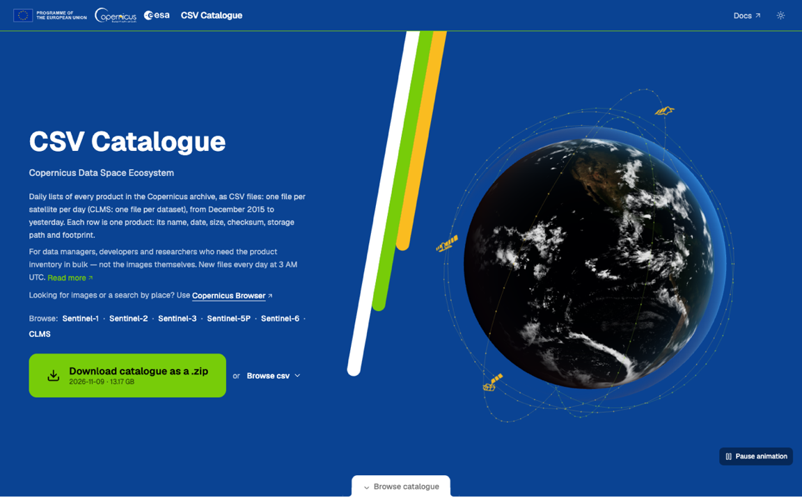

Fig 1: CSV Catalogue start screen

The application consists of two parts:

1. The landing page with a short description of the files, links to the collections and the *Download catalogue as a .zip* button (top of the page).
2. The catalogue browser with the filter panel on the left and the list of CSV files on the right (below the landing page).

Press *?* anywhere in the application to see all keyboard shortcuts (see [Keyboard Shortcuts](#keyboard-shortcuts)). To jump straight to the list with the keyboard, press *Tab* once after the page opens and choose *Skip to files* (on the start page: *Skip to the catalogue*).

## Three Dates of a File

Each CSV file has three dates. The application uses the same words for them everywhere:

- **Generated**: the day the file was last rebuilt. All files are rebuilt daily, so this date says little about their content.
- **First published**: the day the file first appeared in the catalogue.
- **Content changed**: the day the file first appeared or its list of products last changed. Use this date to keep a copy of the files in sync.

For the Sentinel collections, the **content date** is the day on which the products in the file were acquired. All dates are in UTC.

## Landing Page

### Downloading the Complete Catalogue

If you need all CSV files at once, you can download the complete catalogue as a single ZIP archive. The *Download catalogue as a .zip* button shows the date of the archive and its size below the label. Click on the button to start the download.

The complete catalogue is very large (more than 13 GB). If you only need some collections or dates, use the catalogue browser to find and download the files you need.


Fig 2: *Download catalogue as a .zip* button with the archive date and size

If the details of the archive cannot be loaded, the button is disabled. In this case, try again later or download individual files from the catalogue browser.

### Going to the Catalogue Browser

To open a collection directly, click on its name next to *Browse:*, for example *Sentinel-2*. To go to the catalogue browser without choosing a collection, click on the *Browse csv* or *Browse catalogue* button on the landing page, or scroll down.

## Collection Home

When no collection is selected, the catalogue browser shows the collection home. It explains what is in a file (click on *What's in a file*) and lists the collections in two groups:

- **Sentinel missions.** Sentinel-1, -2, -3, -5P and -6 work the same way: one file per satellite per day. For each mission, the list shows what it observes, its satellites (for example 2A, 2B and 2C for Sentinel-2), the newest day available and the number of files. A satellite that has no products in the last 30 days is shown dimmed. Below the newest day, the list says which day is not in yet, because the file of yesterday is published at 3 AM UTC today.
- **CLMS.** The Copernicus Land Monitoring Service is not daily: there is one file per dataset and format. The CLMS card therefore lists the components, popular products and formats instead of a date.

Click on *Open* to open a collection. A Sentinel collection opens with the last 7 days selected.

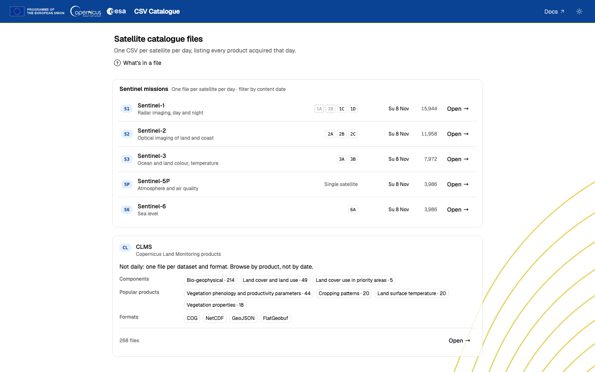

Fig 3: Collection home with the Sentinel missions and the CLMS card

## Catalogue Browser

The catalogue browser lets you find specific CSV files by collection, date and attributes. It consists of:

1. The **filter panel** on the left, where you select a collection, dates and attributes.
2. The **toolbar** above the table, with the filters as a breadcrumb, the number and total size of the files, and the *Copy all URLs*, *Copy link* and *Copy as query* buttons.
3. The **table of CSV files**, grouped by day, where you preview, download and select files.

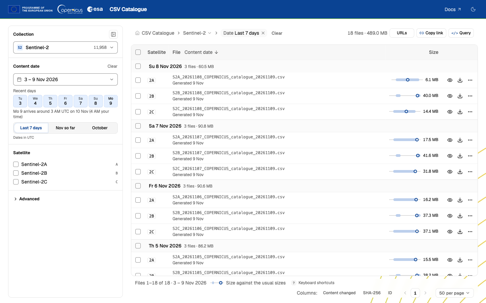

Fig 4: Catalogue browser with the filter panel, toolbar and table of CSV files (Sentinel-2, last 7 days)

### How to Find a CSV File

Let's try to find the Sentinel-2 CSV files from the last 7 days.

1. Scroll down to the catalogue browser or click on *Browse catalogue*.
2. On the collection home, click on the Sentinel-2 row (or on *Open* in it).
3. In the *Content date* filter, *Last 7 days* is already selected.
4. The table shows the Sentinel-2 CSV files with a content date in the last 7 days, as in Fig 4.

To look at a single satellite, tick it in the *Satellite* filter, for example *Sentinel-2A*.

#### Selecting a Collection

The *Collection* drop-down menu at the top of the filter panel is always available. It shows the newest day and the number of files of every collection, so you can switch without going back to the collection home. Switching keeps the filters that also exist in the new collection.

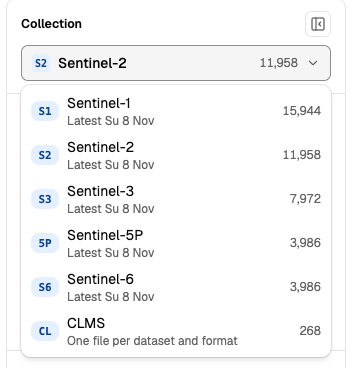

Fig 5: *Collection* drop-down menu with the newest day and the number of files

To return to the collection home, click on *CSV Catalogue* in the breadcrumb. This clears all filters.

#### Filtering by Date

For the Sentinel collections, the *Content date* filter selects the content date of the CSV files.

::: {.callout-note}
## Dates are in UTC
All dates are in UTC. Content dates, the *Recent days* strip and *Content changed since* include their first and last day.
:::

- **Recent days.** Click on one of the seven day buttons to select or unselect a day. With the keyboard, the strip is a single *Tab* stop: use the left and right arrow keys (or *Home* and *End*) to move between the days, and press *Enter* or *Space* to select one.
- **Quick ranges.** Click on *Last 7 days*, *<Month> so far* (the current month) or the name of the previous month, for example *October*.
- **Calendar.** Click on the date field to open the calendar. When no date is set, the field reads *All dates · pick a day, month or year*. In the calendar, you can pick a range, jump by month and year with the *Day* / *Month* / *Year* switch, or type the *From* and *To* dates. Click on *Apply* to use them. The calendar keeps the same height for every month, so the buttons do not move when you change the month.
- **ISO date.** Paste an ISO date or range, such as `2026-10-28` or `2026-10-01..2026-10-31`, into the *ISO date or range* field at the top of the calendar and press *Enter*. The field shows an example range of the last days as a placeholder. A month (`2025-03`) or a year (`2025`) selects all its days. To open the calendar with the cursor in this field, press */*.

The file for a day is published at 3 AM UTC on the following day. Below the day buttons, a note says when the newest day arrives, for example *Mo 9 arrives around 3 AM UTC on 10 Nov (4 AM your time)*. Days after yesterday cannot be selected.

::: {.callout-note}
## New files can be late

New files arrive around 3 AM UTC and can occasionally be late. The application then shows *{day} not in yet* instead of the newest day. Check again later.
:::

To remove the date filter, click on *Clear* above the date field or on the "x" button next to *Date* in the breadcrumb.

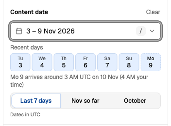

Fig 6: *Content date* filter with the recent days and the quick ranges

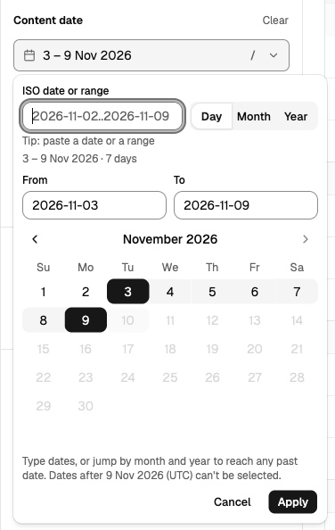

Fig 7: Calendar with the *ISO date or range* field and the *Day* / *Month* / *Year* switch

The CLMS collection does not have a content date, so the *Content date* filter is not shown for it.

#### Filtering by Attributes

Below the date filter, you can narrow down the results by the attributes of the collection. For example, for the Sentinel collections you can select the satellite in the *Satellite* filter. The values are shown as readable labels, such as *Sentinel-2A*, together with the raw value (`A`). Sentinel-1 also has `D`, and Sentinel-3 has only `A` and `B`. Tick one or more values to show only the matching files.

Click on *Advanced* at the bottom of the filter panel to show more filters. For the Sentinel collections, *Content changed since (YYYY-MM-DD)* shows only the files that are new, or whose content changed, on or after this day. It is meant for keeping a copy in sync: enter the day of your last run and download only what changed since then. Type the date, or click on the calendar button next to the field to pick it. The day itself is included, and the date is in UTC. Press *M* to go to this field directly.

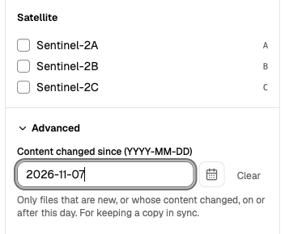

Fig 8: *Satellite* filter and the *Content changed since* filter under *Advanced*

#### Filtering CLMS Datasets

The CLMS collection has its own filters:

- A search box for dataset names, for example "burnt area" or "NDVI".
- *Component* and *Product type*.
- *Area*, for example *Global* or *Europe*.
- *Resolution*, grouped into *Raster* (finest first) and *Vector*.
- *Frequency*, for example *Daily*, *10-daily* or *Yearly*.
- *Projection*: *LAEA* (one pan-European grid, ETRS89-LAEA, EPSG:3035) or *UTM* (tiles in their local UTM zone). This filter is shown only when the results contain both projections. Hover over a value to see what it means.
- *Format*, for example *COG* or *NetCDF*.

The values show the number of files and use readable labels instead of internal names such as `land_surface_temperature`. The filters work together: when you select *Bio-geophysical* as the *Component*, the *Product type* list shows only the product types of this component. Click on *Show all* to see the complete list of values. To remove a filter, click on *Clear* next to its heading or on the "x" button in the breadcrumb.

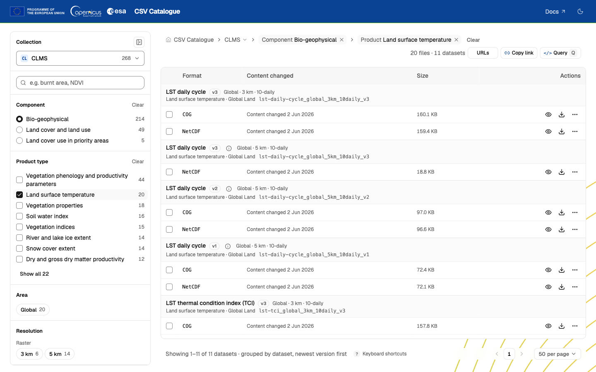

Fig 9: CLMS filters with *Component* and *Product type* selected

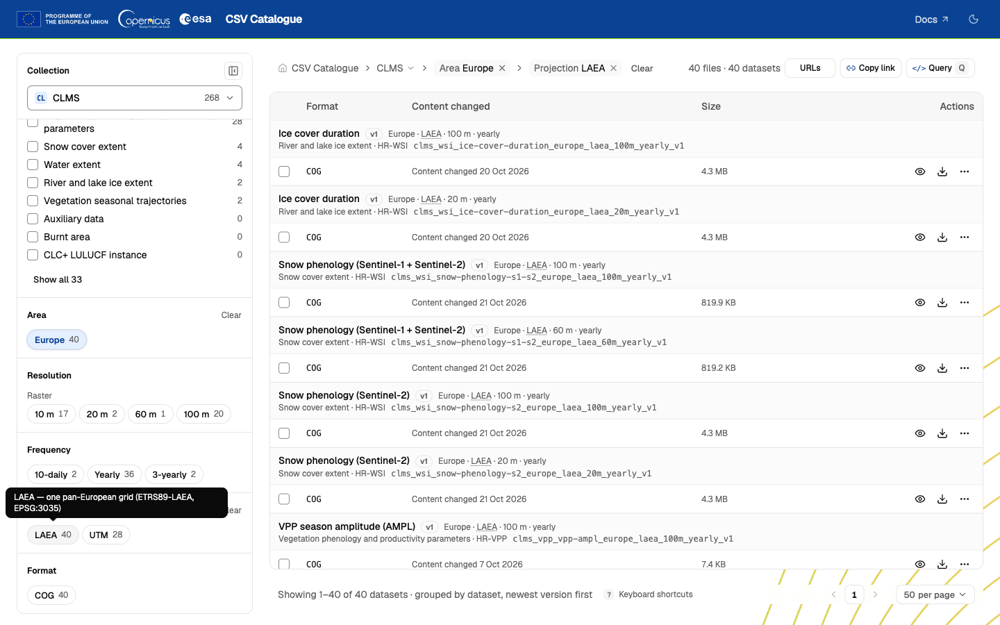

Fig 10: CLMS *Projection* filter with the explanation of *LAEA*

#### Using the Breadcrumb

The toolbar shows the active filters as a breadcrumb, for example *CSV Catalogue > Sentinel-2 > Date Last 7 days > Content changed since 7 Nov 2026*.

- Click on *CSV Catalogue* to go back to the collection home.
- Click on the collection name to switch to a different collection. The filters that also exist in the new collection are kept.
- Click on the "x" next to a filter to remove only this filter. Click on *Clear* (*Clear all*) to remove all of them.

On the right, the toolbar shows the number and total size of the matching files, followed by the *Copy all URLs* (*URLs*), *Copy link* and *Copy as query* (*Query*) buttons. When there is less space, some buttons use the short labels given in brackets.

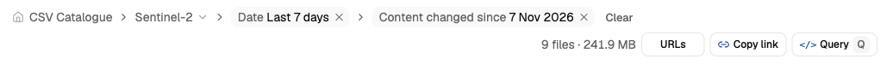

Fig 11: Toolbar with the breadcrumb, the number and size of the files and the *URLs*, *Copy link* and *Query* buttons

#### Hiding the Filter Panel

To get more space for the table, click on the *Hide filters* icon in the upper right corner of the filter panel, or press *F*. To show the panel again, click on the *Filters* button at the beginning of the toolbar. The button shows the number of active filters, and the breadcrumb still shows all of them. The application remembers your choice the next time you open it.

### Table of CSV Files

The table groups the files by content date. Each day has its own row with the number of files and their total size. Each file row shows:

- The checkbox, the *Satellite* and the name of the file. Long file names wrap after an underscore ("_"), so the full name is always visible. Below the name, *Generated 9 Nov* is the day the file was last rebuilt. If the content of the file changed after it was first published, an *Updated* flag shows the day. Hover over the flag to see both dates, for example *Content changed on 2 Jun 2026, after it was first published on 18 Mar 2026*.
- The size of the file, with the size indicator (see below).
- The *Preview*, *Download* and *More actions* buttons.

Use the *Columns* buttons below the table to add the *Content changed* date, the *SHA-256* checksum and the *ID* of the file as columns.

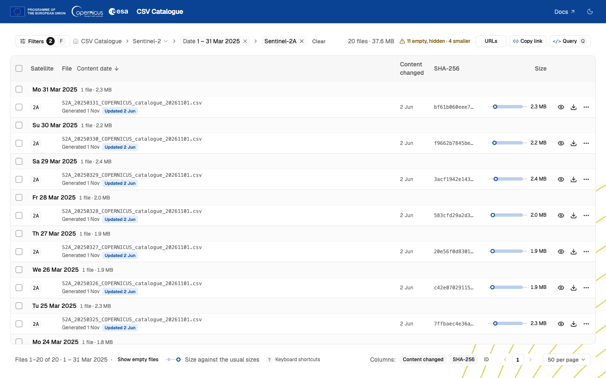

Fig 12: Table of Sentinel-2A files with the *Content changed* and *SHA-256* columns, the *Updated* flags and the filter panel hidden

By default, the newest day is on top. To sort the table by size, click on the *Size* header; click on *Content date* to sort by date again. Click on the same header again to reverse the order. When the table is sorted by size, the days are not grouped.

At the bottom, the table shows which files and days are on the page, for example *Files 1–51 of 1,095 · 15 – 31 Dec 2025*. To change the number of files per page, choose 25, 50, 100 or 200 in the drop-down menu in the lower right corner. A day is never split between two pages, so a page can show a few files more than you chose. Use the page numbers and arrows next to the menu, or press *N* and *P*, to move between pages. The page and the number of files per page are part of the link (see [Sharing a Link](#sharing-a-link)).

#### Size Indicator

Next to the size of each file, the indicator shows how the size compares with the usual sizes of the same satellite. The bar is the usual range, and the dot is the file. A dot inside the bar means the size is usual. If the dot is far outside the bar, the file is marked *Smaller than usual*, *Larger than usual* or *Unusual size*. A small file can mean that the satellite acquired less data that day, so check it before you rely on it. Hover over the flag or the indicator to see the usual range, for example *1.7 MB, below the usual Sentinel-2A size of 2.1–17.4 MB*.

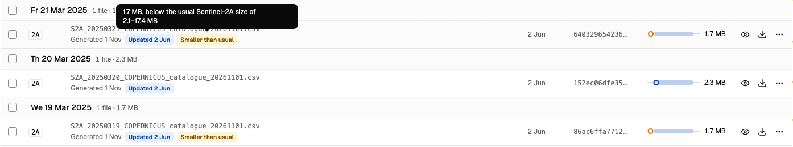

Fig 13: Size indicator with the *Smaller than usual* flag and its explanation

#### Empty Files and Files to Check

Some days have a file with no products.

::: {.callout-note}
## Empty files are hidden

Empty files are hidden by default. The note in the toolbar shows how many there are, and you can show them (see below).
:::

When the list has empty files or files of an unusual size, the toolbar shows a note, for example *⚠ 11 empty, hidden · 4 smaller than usual*. Click on the note to show only these files, including the empty ones; click on it again to show the whole list. While only these files are shown, the toolbar and the bottom of the table say so, for example *15 of 31 files · problem files only*.

The note counts every matching file when the application knows them all: up to 1,000 files, or after *Total size* or *Select all matching files* has loaded them. Otherwise it counts only the files on the current page and says so, for example *⚠ 12 empty on this page*.

To show the empty files together with all other files, click on *Show empty files* at the bottom of the table. An empty file is marked *No products* instead of the size indicator.

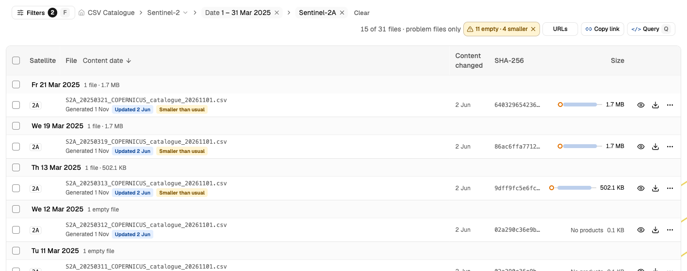

Fig 14: The note *11 empty · 4 smaller* is pressed, and the table shows only these 15 of 31 files

#### When Nothing Matches

If no file matches your filters, the table says *No files match these filters* and offers a next step. Click on the button, for example *Remove Date 1 – 7 Jan 2014*, to remove the filter that causes the empty result. For CLMS, the message is *No datasets match these filters*, with a button to remove the last filter and a *Clear all* button.


Fig 15: Empty result with a button to remove the date filter

#### Previewing a CSV File

Before you download a file, you can check its content in the browser. Click anywhere on the row of the file (or on its *Preview* (eye) icon), or select the row and press *Space*. The preview opens as a drawer on the right side of the table, so you can still see the list. It shows:

- The name of the file and the position in the list (for example *1 of 6*). Use the arrows, or *J* and *K*, to move to the next or the previous file.
- The content date, the number of products, *First published*, *Content changed*, *Generated (rebuilt daily)* and the *CSV file size*.
- The tabs *Map*, *Rows* and *Columns*.

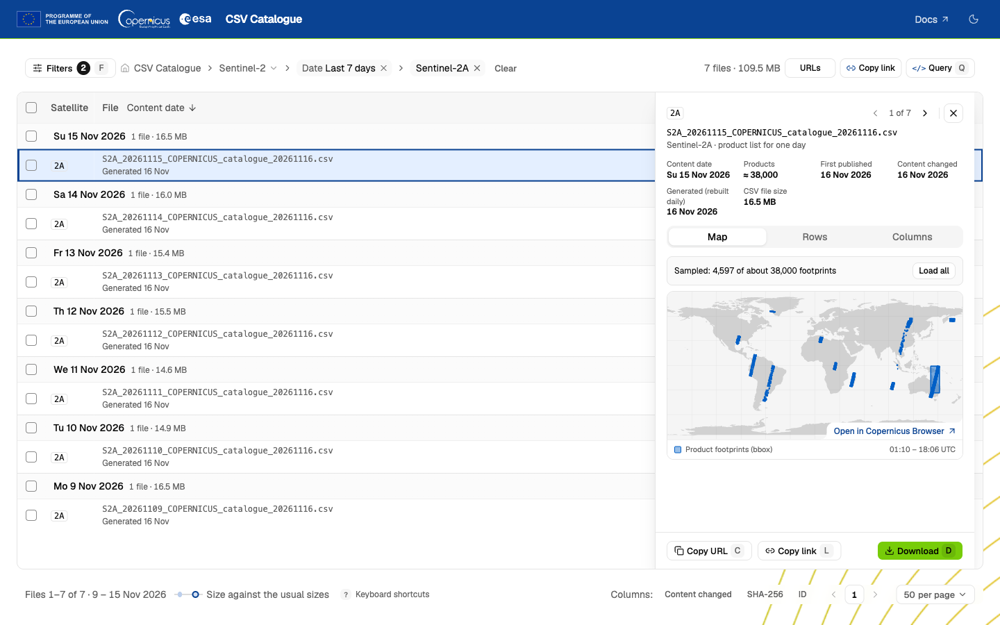

Fig 16: Preview of a Sentinel-2A file with the footprint map

The **Map** tab shows the footprints of the products on a world map, with the time range of the products below it. For a large file, the preview reads the beginning of the file and small samples from across the rest of it, so the map covers the whole day from the start. A note above the map says how many footprints are shown, for example *Sampled: 4,597 of about 38,000 footprints*. Click on *Load all* to read the whole file: the map fills in as it loads, and the button shows how much is loaded. The map draws at most 20,000 footprints, picked evenly from the file.

To see the products of the file as images, click on *Open in Copernicus Browser* in the lower right corner of the map. Copernicus Browser opens in a new tab at the area of the footprints and on the content date of the file.

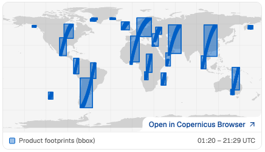

Fig 17: *Open in Copernicus Browser* in the corner of the map

The **Rows** tab shows the first rows of the file. For Sentinel files, it adds a column with the tile (Sentinel-2) or the orbit (Sentinel-1, -3 and -5P) or the pass (Sentinel-6), read from the product name. Click on *Expand* (or press *E*) to see the rows in a larger view with all columns. There, *Find in file* searches the names, for example for a tile or an orbit. While only part of the file is loaded, the result says how much was searched, for example *searched 2,296 of about 92,000 rows*; click on *Load all rows* to search the whole file.

The **Columns** tab lists the columns of the file with a short explanation of each.

In the footer of the preview you can *Copy URL* (*C*), *Copy link* (*L*) and *Download* (*D*) the file. Click on the "x" to close the preview, or press *Esc*. The link of a preview opens the same file for the person you send it to (see [Sharing a Link](#sharing-a-link)).

#### Downloading a Single CSV File

To download a single file, click on the *Download* icon in the row of the file, or in the footer of its preview. The file is saved with its original name.

#### More Actions

The *More actions* ( ... ) menu in the row of a file has the options that are useful in scripts:

- *Copy download URL*, for example for `wget` or `curl`.
- *Copy wget command*.
- *Copy SHA-256 checksum*, for example to verify the integrity of the downloaded file.
- *Copy file ID*, for example to request the file directly from the API.
- *Open in OData API*.

### CLMS Datasets

The CLMS table lists datasets instead of days. Each dataset has a header with a readable name, for example *LST daily cycle*, a version tag such as *v3*, and its area, projection, resolution and frequency. Below the header, the table lists one row per format (for example *COG* and *NetCDF*) with the *Content changed* date and the size.

Every version of a dataset is shown. The versions of the same dataset are grouped together, newest first. When a dataset has more than one version, an ⓘ button follows the version tag. Click on it to read how versions differ and to open the [CDSE documentation of the CLMS products](https://documentation.dataspace.copernicus.eu/Data/CopernicusServices/CLMS.html){target="_blank"}, where you can compare them. The ⓘ next to the version tags always links to this documentation. The CLMS preview has the same *Compare versions in the CDSE documentation* link.

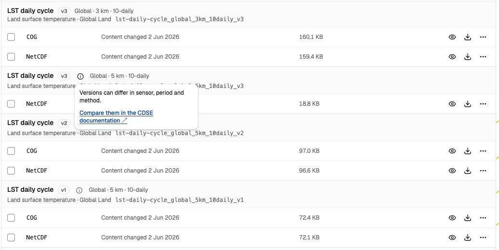

Fig 18: Three versions of the *LST daily cycle* dataset, newest first, with the versions information

The preview of a CLMS file shows the nominal dates of the products instead of a content date, and the rows are sorted by the nominal date, newest first. For a global product, the map shows one band around the globe with a note, for example *Global product: every file covers 180°W–180°E, 70°S–70°N.* The *Columns* tab explains the columns of the CLMS files.

At the bottom, the table shows the number of datasets, for example *Showing 1–50 of 201 datasets · grouped by dataset, newest version first*.

## Downloading Multiple CSV Files

You can select several CSV files and download them together as ZIP archives.

Let's try to download all Sentinel-6 CSV files from the current month.

1. In the *Collection* drop-down menu, click on *Sentinel-6*.
2. In the *Content date* filter, click on the quick range for the current month, for example *Nov so far*.
3. Tick the checkbox in the header of the table to select all files on this page. To select one day, tick the checkbox in its day row.
4. Click on the *Download ZIP* button in the selection bar below the table.

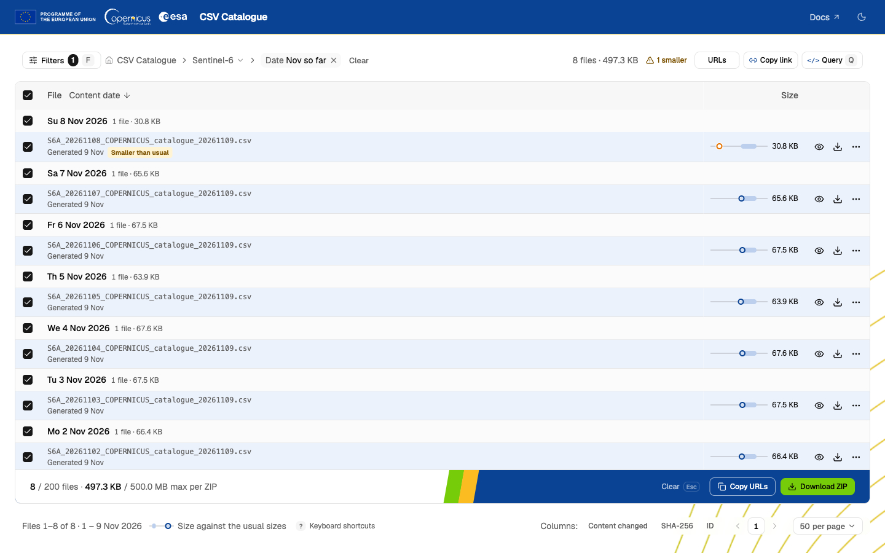

Fig 19: Sentinel-6 files from the current month selected, and the selection bar with the number of selected files, their total size and the *Download ZIP* button

You can also select files one by one with the checkbox at the beginning of each row. Press *X* to select the file in focus, *Shift+X* to select a range and *A* to select the whole day. Your selection is kept when you move to another page, so you can collect files from several pages.

### Selecting All Matching Files

When the files match more than one page, ticking the checkbox in the header selects only the files on the current page. A banner above the table then offers to select all of them, for example *51 files on this page are selected. Select all 1,095 matching files*. Click on it to select every matching file, up to 5,000 files. The banner then shows the total size, for example *All 1,028 matching files are selected (4.28 GB; 67 empty files left out)*. Hidden empty files are left out of the selection. Click on *Clear selection* in the banner to undo it.

::: {.callout-tip}
## More than 5,000 files

*Select all matching files* and *Copy all URLs* work for up to 5,000 files. For larger sets, use *Copy as query* (see [Copy as Query](#copy-as-query)).
:::

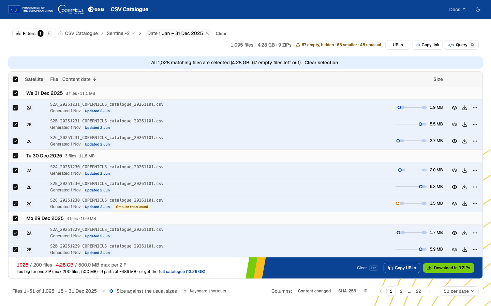

Fig 20: All files of 2025 selected with the banner, and the selection bar with *Download in 9 ZIPs*

### Total Size

The toolbar shows the number of matching files and, when it is known, their total size and the number of ZIP archives they need, for example *1,095 files · 4.28 GB · 9 ZIPs*. For recent days and for up to 1,000 files, the size is shown automatically. For 1,001 to 5,000 files, click on *Total size* to calculate it.

### ZIP Limits and Split Downloads

The selection bar shows the number of selected files and their total size, together with the limits of a single ZIP archive, for example *8 / 200 files · 497.3 KB / 500.0 MB max per ZIP*. 

::: {.callout-note}
## Limits of one ZIP

One ZIP archive can contain at most **200 files** and **500 MB**. A larger selection is split into several ZIPs, or you can copy its URLs instead (see [Copying the URLs](#copying-the-urls)).
:::

If the selection is larger, the bar says so and how it will be split, for example *Too big for one ZIP (max 200 files, 500 MB) · 9 parts of ~486 MB*. The *Download ZIP* button then becomes *Download in 9 ZIPs*: the application prepares the parts one after another and shows the progress of each part in the bar. For very large selections, the bar also links to the full catalogue as one ZIP.

When a ZIP is ready, a notification at the bottom of the screen says *Download started*, with the name and size of the archive. To cancel while a ZIP is being prepared, click on *Cancel* in the bar. To clear the selection, click on *Clear* in the selection bar or press *Esc*.

### Copying the URLs

*Copy URLs* in the selection bar copies the download URLs of the selected files, one per line. You can use them with a download manager or `wget` to download any number of files, without the limits of the ZIP archive. *Copy all URLs* (*URLs*) in the toolbar copies the URLs of all files that match the filters, up to 5,000 files. For more files, use *Copy as query*.

## Copy as Query

If you want to get the same list in a script, click on *Copy as query* (*Query*) in the toolbar, or press *Q*. The dialog shows the current filters as a request to the catalogue API, in five forms: an *OData URL*, a *curl* command, a *wget* command, a *Python* script and *URLs only*. *URLs only* is a command that writes the download URLs into `urls.txt` and then downloads each file with `wget`. Choose a tab and click on its copy button, for example *Copy curl command*, *Copy OData URL* or *Copy Python script*, or click on *Open in browser* to see the response.

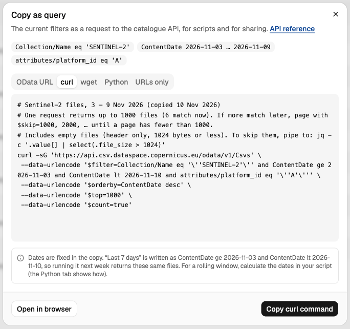

Fig 21: *Copy as query* dialog with the *curl* command

The query syntax is similar to the [OData API](https://documentation.dataspace.copernicus.eu/APIs/OData.html){target="_blank"} of the Copernicus Data Space Ecosystem, which is a good background to read. The CSV catalogue API is its own service, though: it answers with the CSV files, not with the products.

The copy contains the collection, the dates, the attributes and the sort order. The dates are fixed: "Last 7 days" is written as two dates, so running the command next week returns the same files. For a rolling window, calculate the dates in your script, as the *Python* tab does: its script works out the dates each time it runs. The API returns at most 1,000 files per request; the comments in the snippet explain how to get the next pages with `$skip`. The comments also say how to leave out the empty files.

## Sharing a Link

The address in your browser always reflects the current view, so you can bookmark it or share it with others. To copy it, click on *Copy link* in the toolbar or press *L*. When someone opens the link, the catalogue browser opens with the same collection, filters, sort order, page and number of files per page and, if you use the *Copy link* button of a preview, the same file. The selection of files is not part of the link.

The collection is part of the path, and the filters are added as parameters, for example:

```
https://csv.new.dataspace.copernicus.eu/sentinel-2?date=last-7-days&sat=A,C&preview=eabf3799-ea5d-4358-b7ef-2a911b822367
```

Quick ranges, such as *Last 7 days*, stay relative in the link, so it always shows recent files. A range that you pick in the calendar is fixed.

| Parameter | Description | Example |
|-----------|-------------|---------|
| `date` | `last-7-days`, `this-month`, `previous-month`, a day, a month, a year or a range | `date=2025-03` |
| `sat` | Satellite, comma-separated. Other attributes work the same way (`name=value1,value2`). | `sat=A,B` |
| `modified` | Only files whose content changed on or after this day | `modified=2026-11-01` |
| `sort` | `date-desc` (default), `date-asc`, `size-desc` or `size-asc` | `sort=size-desc` |
| `page` | The page of the list, from 1 | `page=2` |
| `size` | Files per page (CLMS: datasets per page): 25, 50 (default), 100 or 200 | `size=100` |
| `preview` | The ID of the file to open in the preview | `preview=eabf3799-ea5d-4358-b7ef-2a911b822367` |

For `date`, a month (`2025-03`) or a year (`2025`) means all its days up to yesterday, and a range is written as `2026-10-01..2026-10-31`.

For CLMS, use `component`, `product_types`, `fileformat`, `area`, `res` (resolution), `freq` (frequency), `proj` (projection: `laea` or `utm`) and `q` (search for a dataset name).

The following collection paths are available: `/sentinel-1`, `/sentinel-2`, `/sentinel-3`, `/sentinel-5p`, `/sentinel-6` and `/clms`.

If part of a link is not valid, for example an unknown sort order, the application ignores that part and says so in a light-blue notice above the table, for example *Part of this link wasn't valid and was ignored: sort, page size.* Click on the "x" to close the notice.

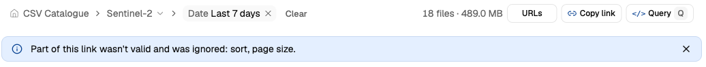

Fig 22: Notice about the parts of a link that were ignored

### Bookmarks from the Old Site

Bookmarks of the previous version of the CSV Catalogue still work. A folder of a satellite, a year or a month, for example `/Sentinel-2/S2A/2025/`, opens the same files in the new catalogue (`/sentinel-2?sat=A&date=2025`). An old CLMS folder, for example `/CLMS/bio-geophysical/`, opens the CLMS collection with the same component and product type. The first time, a notice says *This page moved. Here is the same view in the new catalogue.* Update your bookmark to the new address.

## Notifications

The application keeps its messages short and close to what you did:

- **In place.** When you click on a copy button that stays on the screen, such as *Copy link*, *Copy URLs* or *Copy* in the *Copy as query* dialog, the button itself shows *✓ Copied* for a moment.
- **Cards.** When the button goes away, for example after an item of the *More actions* menu, and for downloads, a small card appears at the bottom centre of the screen, for example *Download URL copied* or *Download started*. Errors stay longer and have a close button, and some have a *Retry* button.
- **Banners.** When the catalogue cannot be reached, or when it is busy for a moment, an amber banner above the table explains what happened, keeps your filters and offers *Try again*. Light-blue notices tell you about a link that was changed or an old bookmark.

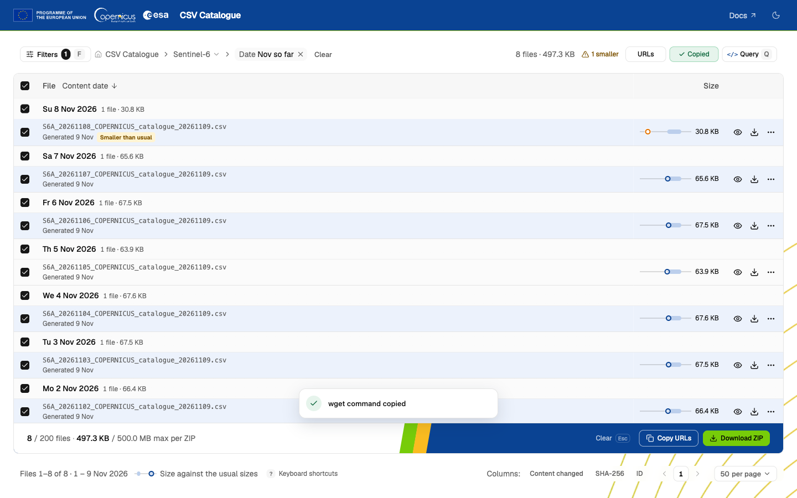

Fig 23: *✓ Copied* on the *Copy link* button, and a card at the bottom of the screen

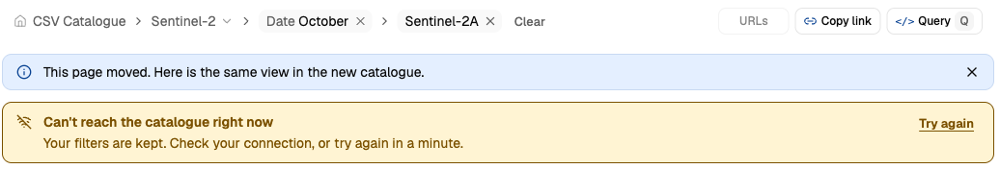

Fig 24: Light-blue notice for an old bookmark and the amber banner when the catalogue cannot be reached

## Phones and Tablets

With a mouse or a touchpad, the filter panel is shown next to the table from 1,024 pixels wide; between 1,024 and 1,280 pixels it is narrower. On touch screens narrower than 1,280 pixels, and on any screen narrower than 1,024 pixels, the filter panel is not shown next to the table: click on the *Filters* button in the toolbar to open the filters as a sheet.

On laptops with a short window, for example 1,280 × 600, the application keeps the same look as on a large screen. When the window is very short, the page scrolls instead of the table: the selection bar then stays at the bottom of the window, and the preview opens at the right edge of the window.

On phones (narrower than 640 pixels), the files are shown as cards; tap the name of a file to preview it in a sheet. The selection bar stays at the bottom of the screen, with the *Clear*, *Copy URLs* and *Download* buttons.

## Keyboard Shortcuts

The application has single-key shortcuts that work when the focus is not in a text field. Press *?* to see the list. No shortcut replaces a keyboard shortcut of the browser.

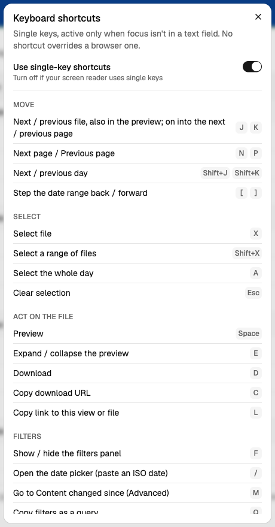

Fig 25: List of keyboard shortcuts

| Key | Action |
|-----|--------|
| *J*, *K* | Next or previous file, also in the preview; continues onto the next or previous page |
| *N*, *P* | Next or previous page |
| *Shift+J*, *Shift+K* | Next or previous day |
| *[*, *]* | Step the date range back or forward |
| *X* | Select a file |
| *Shift+X* | Select a range of files |
| *A* | Select the whole day |
| *Esc* | Clear the selection |
| *Space* | Preview |
| *E* | Expand or collapse the preview |
| *D* | Download |
| *C* | Copy the download URL |
| *L* | Copy the link to this view or file |
| *F* | Show or hide the filter panel |
| */* | Open the calendar with the cursor in the ISO date field |
| *M* | Go to *Content changed since* (under *Advanced*) |
| *Q* | Copy filters as a query |
| *T* | Switch between the light and dark theme |
| *?* | Show the shortcuts |

If your screen reader uses single keys, turn off *Use single-key shortcuts* at the top of the list, under its title. The application remembers this setting.

## Appearance

The CSV Catalogue supports a light and a dark theme. By default, it follows the setting of your operating system. To switch between the themes, click on the sun / moon icon in the upper right corner of the page, or press the *T* key on your keyboard.
