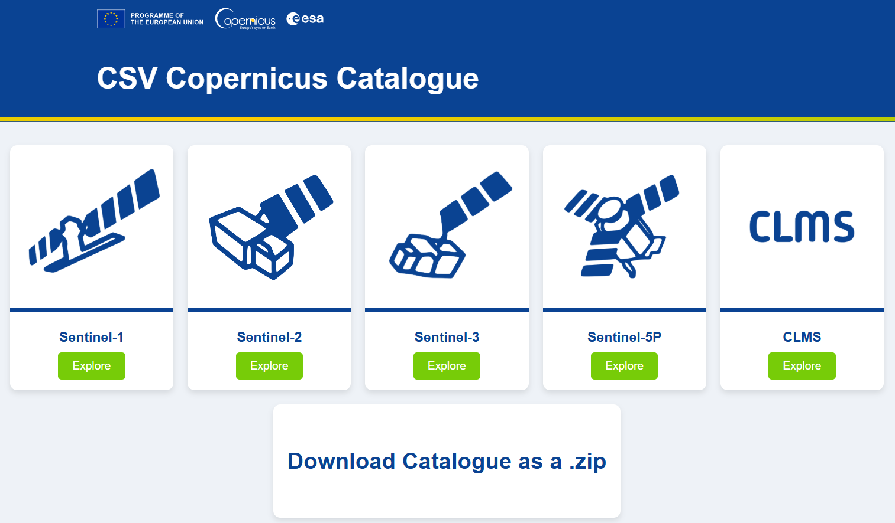

This webpage enables users to access and download Sentinel-1, Sentinel-2, Sentinel-3, Sentinel-5P and CLMS product lists in csv format.

::: {.callout-warning}
IMPORTANT NOTICE! \
We would like to inform you that, from January 20th 2027, the old Copernicus Catalogue CSV interface to which this guide refers to will be replaced by a new interface. \
You can find information regarding the new interface at the link below: \
[https://documentation.dataspace.copernicus.eu/Applications/CSVCatalogue.html](https://documentation.dataspace.copernicus.eu/Applications/CSVCatalogue.html){target="_blank"}

Both interfaces will be available until January 20th: \
OLD - [https://csv.dataspace.copernicus.eu](https://csv.dataspace.copernicus.eu){target="_blank"} \
NEW - [https://csv.new.dataspace.copernicus.eu](https://csv.new.dataspace.copernicus.eu){target="_blank"} \
However, after January 20th, the Catalogue CSV service accessible at "https://csv.dataspace.copernicus.eu" will be available only under the new interface.

After January 20th, there will also be a redirection from "https://csv.new.dataspace.copernicus.eu/" to "https://csv.dataspace.copernicus.eu".

News item: \
Please note that the CSV Catalogue API "https://api.csv.dataspace.copernicus.eu" will not be affected by these changes.
:::

#### CSV Copernicus Catalogue

Discover the webpage via [CSV Copernicus Catalogue](https://csv.dataspace.copernicus.eu/){target="_blank"}.

